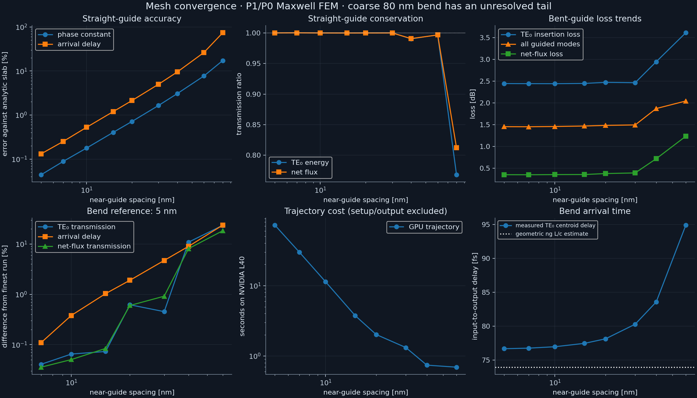
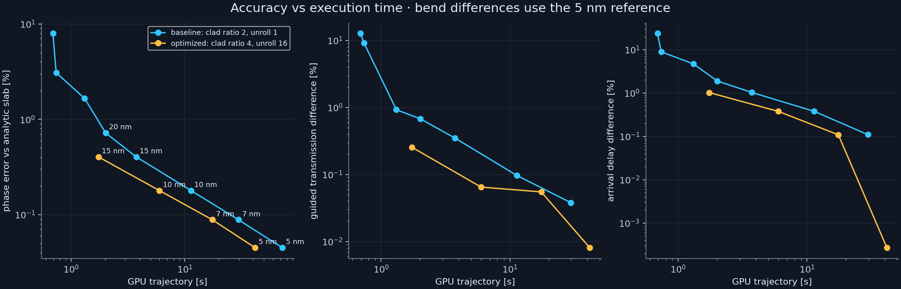
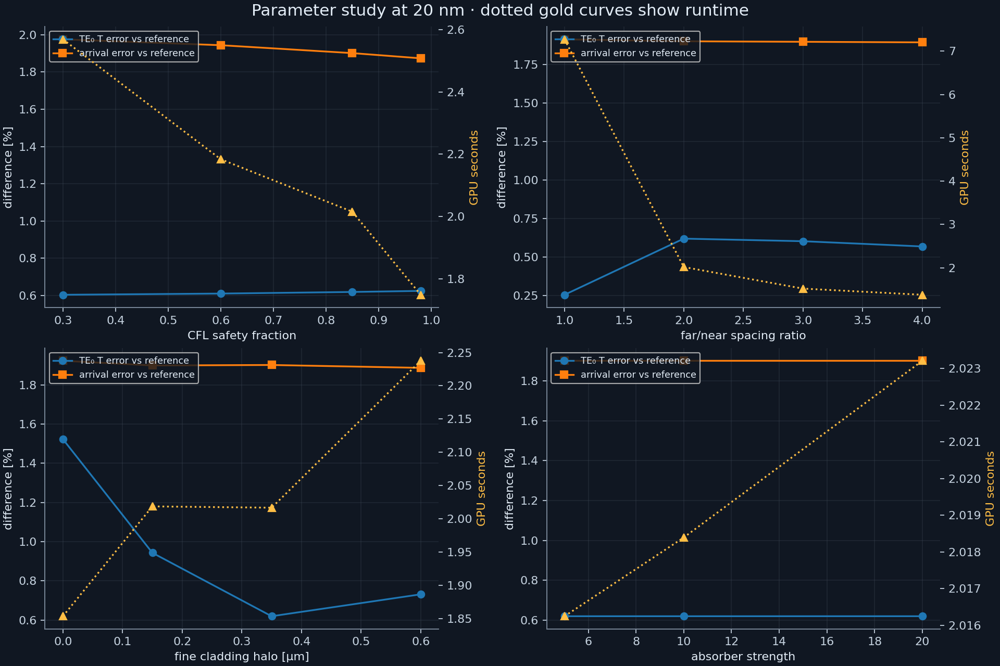
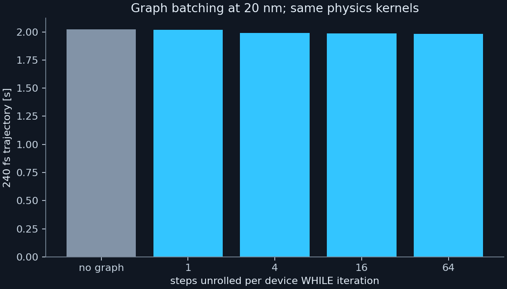
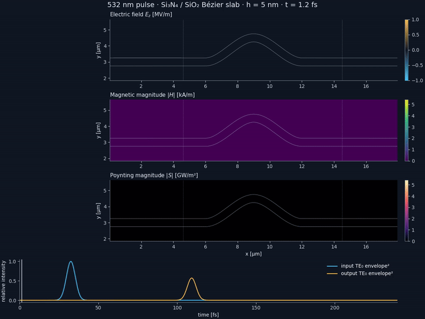

# fiber-pulse-fem

A graph-capturable GPU Maxwell solver for a visible-light pulse in a conforming,
Bézier-shaped 2D slab waveguide. The original Python/MATLAB implementation is retained below.

## Warp FEM solver

```bash
python -m pip install -r requirements.txt
# Limit host BLAS/OpenMP threads for reproducible setup timings.
export OPENBLAS_NUM_THREADS=1 OMP_NUM_THREADS=1
python warp_waveguide.py --h 0.04 --out results/preview
python warp_waveguide.py --h 0.01 --frames --out results/quality
python render_warp.py --run results/quality --out artifacts
python -m unittest -v test_waveguide
```

`--h` is the requested near-guide edge spacing **in µm**, not a grid dimension.
The Triangle maximum-area constraint is `0.5*(h*clad_ratio)^2`; actual element sizes
vary near the curved interface. Arbitrary positive spacings are accepted, subject to
host/device memory. `--clad-ratio` and `--halo` control static domain refinement.
The fine band has vertical half-width `width/2 + halo` around the centerline;
its normal thickness varies through the bend.
`--mesh-from results/quality/mesh.npz` reuses exactly the same host mesh.
The mesh archive stores positions in µm, zero-based triangles, material labels,
the outline/centerline, and geometry configuration.

CUDA with conditional graph support (CUDA 12.4+, compatible NVIDIA driver) is
required for the full-device loop. Tested with Warp 1.15.0 and an NVIDIA L40.
`--no-graph` queues ordinary Warp launches for debugging/comparison. It runs the
same kernels but incurs Python launch overhead. No CPU time-domain solver or
SciPy sparse operation is used by the production trajectory.

### Physical and numerical model

* 532 nm carrier; nondispersive, lossless core index 2.04 and cladding index 1.46.
  These are an idealized material model, not a prediction including measured
  material dispersion or absorption. The core supports three guided E_z slab modes.
* An 18 × 8 µm box, 0.5 µm core, and straight leads at y = 3 µm. Two cubic Bézier
  segments between x = 6 and 12 µm form a 1.5 µm bump, with horizontal endpoint
  tangents. This tighter bend makes mode conversion and radiation measurable.
  `--bend 0` produces the analytic straight-guide control.
* Matched electric and magnetic current sheets at x = 2.5 µm launch TE₀ to the
  right. The default Gaussian **field** envelope has sigma = 4 fs (9.42 fs field
  FWHM; 6.66 fs intensity FWHM), centered at 18 fs. `--sigma 8` restores the
  original approximately 19 fs field FWHM. Pulse width changes the experiment.
* Continuous P1 E_z and discontinuous P0 H_x,H_y. `warp.fem.Trimesh2D`, polynomial
  spaces, and weak-form integration assemble electric lumped mass, magnetic cell
  mass, and the derivative matrices entirely on the GPU. Fused Warp CSR kernels
  apply these operators in a staggered leapfrog update. P1 row-sum lumping is
  positive; naive triangular P2 row-sum lumping is not a safe higher-order upgrade
  (vertex integrals vanish), so this implementation deliberately retains P1/P0.
* Crank–Nicolson local damping with equal electric/magnetic loss rates in a
  1.5 µm cubic sponge at all edges. This is a lossy sponge, **not a PML**. The
  outer weak boundary is reflecting; the sponge attenuates waves before return.
* Internal coordinates are x/(1 µm), time is c₀t/(1 µm), electric field is E/E₀,
  and magnetic field is Z₀H/E₀, with E₀ = 1 MV/m. This nondimensionalization is
  exactly equivalent to SI Maxwell equations and avoids poorly scaled fp32 values.
  Output times are fs, beta is rad/µm, power is W/m of invariant slab depth, and
  pulse fluence is J/m. Frame archives are normalized, with SI conversion in the renderer.

The time step is a requested fraction of `2/sqrt(B)`, where B is a conservative
triangle-wise absolute-row-sum bound on the spectral radius of M⁻¹K. It accounts
for the smallest/most distorted cells, not just the nominal h. `--cfl` must lie in
(0,1]; decreasing it isolates temporal error. This bound can be more restrictive
than the exact eigenvalue-based limit used by the original solver.

### Device execution and measurements

Setup creates the host mesh, material/source coefficients, a conservative CFL
bound, and exact triangle/monitor intersections. After FEM assembly and kernel
warm-up, **one CUDA graph launch advances the entire trajectory**. A conditional
while-node reads a device step counter. Field updates, analytic source evaluation,
monitor reductions, frame rasterization, and counter increments all run on device.
There are no allocations, host callbacks, field transfers, convergence checks, or
host synchronizations inside the trajectory. A single completion synchronization
precedes result readback. `trajectory.dot` records the actual captured graph.

Monitors use three-point Gaussian quadrature along exact vertical cuts through
the triangles. E is centered in time to match staggered H before computing flux.
Nine input-lead probes (x = 4.0…5.6 µm) fit beta from the carrier-frequency complex
phase. The analytic beta selects the phase-unwrapping branch; the fit slope is
free. Input/output measurements are at x = 4.6 and 14.5 µm, outside the sponge.

The saved metrics distinguish:

* TE₀ forward pulse-energy transmission, TE₀ carrier-frequency transmission, and
  transmission into TE₁ and TE₂, using modal E/H overlaps. Their admittances and
  profiles are evaluated at the carrier, a narrowband approximation.
* Total net Poynting fluence through the whole domain cross-section, which
  includes radiation and other guided modes; a ±0.9 µm window is also reported.
  Radiation absorbed at the top/bottom before the output cut is absent from this metric.
* Hilbert-envelope intensity-centroid arrival time and input-to-output delay.
  Straight-guide delay is compared with analytic n_g Δx/c₀. For the bend, the
  geometric n_g L/c₀ estimate is only a reference scale: curvature, mode conversion,
  and spectral filtering can change the physical delay. Bend accuracy is assessed
  against a finer numerical run.

`metrics.json` includes configuration, source SHA256 hashes, mesh sizes, dt, timing,
phase-fit residual, final-field amplitude, and output-window tail fraction. Mesh,
FEM setup/capture, and GPU trajectory times are separate; disk compression and
rendering are excluded from those timings. All trace samples remain on device
until completion. Animation raster frames also remain on device; only their
post-run archive uses fp16 to save space. Physics and quantitative traces use fp32,
with fp64 accumulation in the port reductions.

### Reproduce the studies

```bash
python sweep_waveguide.py --study resolution
python sweep_waveguide.py --study parameters
python sweep_waveguide.py --study reference
python render_warp.py --study results/study --out artifacts
```

The runner uses one GPU simulation at a time and resumes completed cases; pass
`--rerun` after code/configuration changes. The 80 nm case runs for 480 fs, the
60 nm case for 280 fs, and finer resolution cases for 240 fs to capture slow
coarse-mesh tails. Compare runtimes with those different durations in mind.
Full field/mesh archives stay under ignored `results/`; compact measurements and
figures are committed under `artifacts/`. See the measured results below.

<!-- warp-results-start -->
## Measured results (NVIDIA L40, Warp 1.15.0)

The committed study contains 44 runs. Raw configurations and measurements are in
[artifacts/measurements.csv](artifacts/measurements.csv) and the adjacent JSON files.
Timings are measurements on this host, not portable performance guarantees.

| h [nm] | phase error [%] | straight arrival error [%] | bend TE₀ T [%] | bend guided T [%] | bend delay [fs] | GPU [s] |
|---:|---:|---:|---:|---:|---:|---:|
| 80 | 17.8775 | 73.9303 | — | — | — | 0.86 |
| 60 | 7.9363 | 26.2998 | 43.510 | 62.422 | 94.905 | 0.69 |
| 40 | 3.0800 | 9.5273 | 50.728 | 64.973 | 83.574 | 0.74 |
| 30 | 1.6547 | 4.9949 | 56.668 | 70.844 | 80.299 | 1.32 |
| 20 | 0.7191 | 2.1308 | 56.573 | 71.019 | 78.141 | 2.01 |
| 15 | 0.4034 | 1.1918 | 56.884 | 71.254 | 77.475 | 3.74 |
| 10 | 0.1791 | 0.5258 | 56.962 | 71.436 | 76.975 | 11.35 |
| 7 | 0.0883 | 0.2512 | 56.949 | 71.532 | 76.767 | 29.76 |
| 5 | 0.0450 | 0.1315 | 56.926 | 71.505 | 76.683 | 72.46 |

The 80 nm bend still has a substantial late-time tail at 480 fs; its transmission
and centroid are not accepted quantitative measurements. It is a preview setting.
Finer runs have negligible late-window TE₀ energy. Small straight-guide modal
transmission values above one reflect finite-element port sampling and the fixed
carrier-admittance approximation; net flux is the stronger conservation check.



### Recommended settings

The following runs use a nominal 0.35 µm vertical cladding halo, CFL fraction 0.85,
and 16 steps per device graph iteration. The distant-cladding spacing is 4h.

| h [nm] | vertices | GPU [s] | mesh + setup + run [s] | phase error [%] | guided T difference vs 5 nm reference [%] | arrival difference [%] |
|---:|---:|---:|---:|---:|---:|---:|
| 15 | 193,889 | 1.74 | 2.99 | 0.4034 | 0.2548 | 1.0286 |
| 10 | 427,001 | 5.98 | 8.22 | 0.1791 | 0.0648 | 0.3785 |
| 7 | 911,796 | 17.53 | 22.44 | 0.0883 | 0.0550 | 0.1090 |
| 5 | 1,695,565 | 41.71 | 51.36 | 0.0450 | 0.0081 | 0.0003 |

Use **10 nm** for routine iteration and **5 nm** for the highest tested quality
at a practical cost on this GPU. These are empirical choices within the tested
P1/P0 scheme, not a global optimum over all FEM discretizations.

```bash
python warp_waveguide.py --h 0.01 --clad-ratio 4 --graph-unroll 16 --out results/balanced
python warp_waveguide.py --h 0.005 --clad-ratio 4 --graph-unroll 16 --frames --out results/quality
python render_warp.py --run results/quality --out artifacts
```

Mesh/setup/run totals exclude archive compression and rendering. Most reference and
resolution timing records predate the faster polygon classification;
older setup timers excluded the small host CFL prepass (see the JSON flag). Optimized-run totals
include that prepass. Mesh vertices, connectivity, and material labels were verified
bitwise identical before/after the classification optimization at 20 and 7 nm.



### What converged, and what the loss means

The finest baseline has β = 23.566433 rad/µm in the input lead, compared
with the analytic 23.555831 rad/µm. Straight-guide phase error
decreases approximately quadratically with spacing. Straight-guide pulse delay
at 5 nm differs from analytic n_g Δx/c₀ by 0.132%.

For the bend, the 5 nm baseline transmits 56.926% in TE₀
(2.447 dB insertion loss), and 71.505%
in all guided modes (1.457 dB guided-power loss).
TE₀/TE₁/TE₂ forward energy ratios are 0.569255, 0.027118, 0.118912.
Individual mode ratios use incident TE₀ energy; summed guided transmission uses
all incident guided energy. The finite-bandwidth source has about 0.033% higher-mode
content at the input, which is included in that normalization.
Net cross-section flux transmission is 92.161%, including radiation.
The TE₀ envelope centroid delay is 76.683 fs; the geometric n_g L/c₀
estimate is 73.962 fs. The difference from that geometric estimate
is not itself a discretization error: the converged bend filters the pulse spectrum
and changes propagation relative to the straight slab.

At 20 nm, reducing CFL from 0.98 to 0.30 changes delay by only about 0.08 fs;
spatial dispersion dominates. A fine evanescent halo matters. At that resolution,
a far/near ratio of 4 preserves guided power reasonably well but changes total
radiation flux noticeably; the recommended fine runs were checked separately.
Changing sponge strength from 5 to 20 leaves guided transmission nearly unchanged
while moving full-plane net flux by about 1.2 percentage points. Therefore the
guided transmission is better established than the radiation/absorption balance.
A true PML, domain-size convergence, and frequency-dependent port admittances would
be useful next checks for more precise radiation or broadband measurements.

Changing sigma from 4 to 8 fs is a change of physical input bandwidth, not a
numerical refinement: TE₀ transmission changes while summed guided transmission
is nearly unchanged in the 20 nm study.

Graph batching has only a small timing effect here (about 2.02 s unbatched versus
1.99 s with 16 steps). Its main benefit is keeping the complete trajectory independent
of host scheduling. Most of the optimized speedup comes from the coarser distant cladding.




### Animation and verification

[MP4 animation](artifacts/pulse.mp4) · [snapshot](artifacts/pulse_snapshot.png) ·
[captured CUDA graph](artifacts/trajectory.dot) · [animation-run metrics](artifacts/quality_metrics.json)

The [quality port traces](artifacts/quality_traces.npz) and
[reference port traces](artifacts/reference_traces.npz) retain the quantitative data.



The animation shows instantaneous E, magnetic magnitude, and Poynting magnitude,
with the input/output TE₀ intensity envelopes below. Raster frames are sampled
on device; video encoding happens after the simulation.

Verification includes arbitrary/nonpreset mesh resolutions in both host meshers,
conforming material interfaces, Warp FEM assembly against analytic triangle
operators, full-graph trajectories against independent float64 NumPy/SciPy
stepping, bitwise graph replay, and a lossless discrete-energy invariant.
The comparison errors are about 1e-5; lossless energy drift is about 1e-7.
See [artifacts/verification.txt](artifacts/verification.txt) for the executed checks.

Reproduce additional tuning plots with:

```bash
python sweep_waveguide.py --study graph
python sweep_waveguide.py --study optimized
python render_warp.py --study results/study --out artifacts
python report_waveguide.py
```

<!-- warp-results-end -->

## Original implementation

Time-domain finite-element electromagnetic simulation of a visible-light pulse in a curved
dielectric channel (a 2D slab-waveguide analogue of an optical fiber), with animations and
visualizations of E, H and the Poynting vector.

## Model

* 25 µm × 25 µm domain with a 0.5 µm thick Si₃N₄ channel (n = 2.04) in SiO₂ (n = 1.46).
* Out-of-plane E_z (TE polarisation); first-order Maxwell system in SI units.
* E_z is piecewise linear on mesh vertices, H is piecewise constant on triangles, and the
  Poynting vector S = E × H is evaluated per triangle. Explicit leapfrog time stepping with a
  lumped mass matrix.
* The pulse (λ₀ = 532 nm, ~19 fs FWHM Gaussian envelope) is the fundamental TE mode of the
  straight slab, injected one-way by a matched electric + magnetic current sheet.
* Impedance-matched absorbing layers (equal electric and magnetic loss rates) on all edges.

## Usage

Two equivalent implementations of the simulation write the same cache layout:

* `fiber_pulse.py` (Python, libigl): meshing, outline/offset of the cubic Bézier channel and
  operator construction use libigl; the spline helpers that libigl lacks (offsetting, adaptive
  flattening) are ported on top of `igl.cubic_is_flat` / `igl.cubic_split`.

      python3 fiber_pulse.py --out run            # full resolution
      python3 fiber_pulse.py --quick --out run    # coarse, short preview (seconds)

* `fiber_pulse.m` (MATLAB, gptoolbox): the original implementation; also writes an mp4 and a
  summary png.

      matlab -nodisplay -batch fiber_pulse
      matlab -nodisplay -batch "quick=true; fiber_pulse"

Both write `fiber_pulse_mesh_v6.mat` (mesh, core mask, time-averaged ⟨S⟩, mode data) and one
`fiber_pulse_fields/frame_*.mat` per animation frame (about 2 GB at full resolution).

`render_fiber_pulse.py` renders from the cached frames without rerunning the simulation:

    python3 render_fiber_pulse.py --dir run [png] [apex] [hd]

* `fiber_pulse_hd.mp4`: E_z, |H| and |S| animation
* `fiber_pulse_apex.mp4`: close-up of the pulse at the top of the bump
* `fiber_pulse_poynting_hd.png`: time-averaged Poynting vector as oriented line integral
  convolution

### Agreement between the two implementations

The Python port reproduces the MATLAB geometry exactly (offset spline, flattened outline) and,
given the same mesh (`--mesh-from`), the fields to about 1e-7 relative error (the cache is
stored in single precision) and the time-averaged ⟨S⟩ to about 3e-9. Meshes generated
independently by the two can differ slightly: the hex-lattice points differ by one rounding
error, which changes how Triangle breaks ties among cocircular points. Fed MATLAB's exact
lattice points, libigl's `triangle.triangulate` returns an identical mesh.

## Dependencies

* Python: `pip install -r requirements.txt` (libigl ≥ 2.6.3 for `igl.triangle`), and `ffmpeg` on the
  path for the animations.
* MATLAB version only: [gptoolbox](https://github.com/alecjacobson/gptoolbox) on the path
  (`triangulate`, `grad`, `spline_offset`, `spline_to_poly`, ...).

Written with Claude Code.
