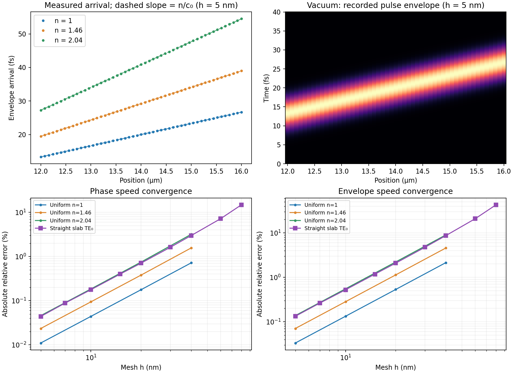
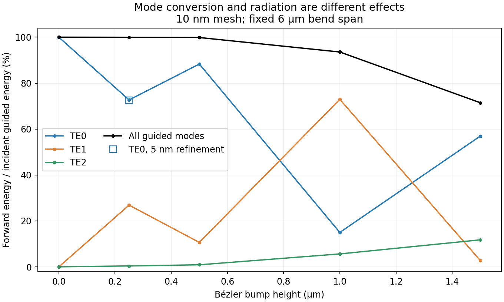

# fiber-pulse-fem

A graph-capturable GPU Maxwell solver for a visible-light pulse in a conforming,
Bézier-shaped 2D slab waveguide. The original Python/MATLAB implementation is retained below.

## Speed-of-light verification

The simulation recovers the physical light speed with convergent discretization
error. `C0 = 299792458 m/s`; coordinates are in µm and internal time is
`tau = c0*t/(1 µm)`, so one time unit is **3.33564095198 fs**. In a uniform,
nonmagnetic dielectric, the assembled equations give
`n² * d²E/dtau² = Laplacian(E)`, hence speed `c0/n`.

`check_light_speed.py` independently tests this using the production Warp FEM
assembly, leapfrog kernels, and full-trajectory CUDA graph. It initializes a
532 nm vacuum-wavelength Gaussian electric packet with **zero magnetic field and
no source**. The packet splits into left/right waves; no source phase velocity or
group delay is prescribed. A 24 × 0.16 µm triangular strip is uniform transversely,
with natural side boundaries and absorbing x ends. The packet starts at x=8 µm;
51 probes span x=12–16 µm. The enlarged domain keeps boundary returns outside the
measurement window. Envelope-energy centroids give arrival-time slopes, and
Fourier phase at the carrier gives phase speed. Probe spacing is small enough to
unwrap the phase directly, without an analytic propagation-constant anchor.

Twelve new runs cover h=40, 20, 10, 5 nm and n=1, 1.46, 2.04 at CFL=0.85.
Both speed errors decrease approximately fourfold on halving h. At **h=5 nm**:

| Medium | Expected envelope speed (m/s) | Measured (m/s) | Envelope error | Phase-speed error |
|---|---:|---:|---:|---:|
| Vacuum | 299,792,458 | 299,692,637 | −0.0333% | −0.0110% |
| Uniform n=1.46 | 205,337,300 | 205,192,033 | −0.0707% | −0.0235% |
| Uniform n=2.04 | 146,957,087 | 146,754,249 | −0.1380% | −0.0460% |
| Straight slab TE₀ | 144,954,310 | 144,761,058 | −0.1333% | −0.0440% |

The straight-guide row reuses the previous nine-resolution study, with its
original provenance retained in `artifacts/light_speed/straight_guide.json`.
Here `n_eff=1.99448237` gives phase speed **150,310,909 m/s**, whereas
`n_g=d beta/d k0=2.06818589` gives envelope speed **144,954,310 m/s**.
The measured group speed uses the arrival slope in the straight input lead.
These differ from vacuum light speed for physical reasons. The model uses
constant material indices, so its group-index correction includes waveguide
dispersion but not material dispersion. Across a bend, path length, mode
conversion, and pulse reshaping also affect arrival time; that delay alone is
not a clean vacuum-speed test.

Coarse meshes substantially slow the pulse numerically: at h=40 nm the uniform
n=2.04 envelope error is −9.03%, versus −0.138% at 5 nm. Correct SI units do not
remove numerical dispersion. These checks complement the integrator benchmark's
phase and delay gates; the homogeneous experiment itself uses leapfrog.



[Animated measured envelopes](artifacts/light_speed/envelopes.gif),
[raw measurements](artifacts/light_speed/measurements.json), and all twelve probe
archives and graph descriptions are in `artifacts/light_speed/`. The animation
compares envelopes at the same physical time, normalized separately by peak
amplitude. **All 13 regressions pass**, including independent SI timing,
source-free propagation/convergence, and device graph replay without host
transfers. The homogeneous runs take about 0.10 s each at 5 nm on the L40,
excluding setup; their thin uniform strips are much cheaper than the bent guide.

```bash
python check_light_speed.py
python report_light_speed.py
python -m unittest -v test_waveguide test_integrators test_light_speed
```

## Phenomenology assessment

The straight-guide propagation is quantitatively supported by analytic slab
theory; bend-induced mode conversion and loss of guided power are physically
consistent, but the exact radiation budget remains less well validated.
This is an idealized 2D, lossless, nondispersive slab with E_z/H_x/H_y fields,
not a full three-dimensional fiber model.

The [MIT slab-waveguide derivation](https://ocw.mit.edu/courses/6-974-fundamentals-of-photonics-quantum-electronics-spring-2006/bf3bdeb971819ddc9c68719d28bb2745_classnotes.pdf)
(section 2.7) predicts three guided modes at 532 nm: effective indices
1.99448, 1.85536, and 1.62070. The half-width V parameter is 4.20684.
The fundamental field has a cladding amplitude decay length of 62.3 nm.
`assess_phenomenology.py` independently checks its group index using the
Hellmann–Feynman identity
`ng = integral(n² |E|²) / (neff * integral(|E|²))`, obtaining 2.0681858880,
consistent with the derivative of beta. Group index exceeding the core index
is therefore expected here. The connection between group and energy velocity
is discussed in [MIT's nanophotonics notes](https://math.mit.edu/~stevenj/18.369/spring16/).
The existing 5 nm straight control gives 100.009% guided transmission and a
68.387 fs delay versus the analytic 68.297 fs over 9.9 µm; the small excess
transmission is a diagnostic/discretization error, not gain.

The default bend has minimum centerline radius 1 µm. Its tangent is continuous,
but curvature jumps where the cubics meet the straight leads. This is a tight
multimode bend; smooth appearance alone does not make propagation adiabatic.
Both [bend-mode mismatch and radiation](https://optics.ansys.com/hc/en-us/articles/360042799933-Bent-waveguide-analysis)
and [strong intermodal mixing](https://www.nature.com/articles/ncomms2232) are
expected mechanisms. Published examples support these mechanisms, not the exact
loss value of this particular geometry.

Five additional controls vary bump height at fixed 6 µm span, 10 nm mesh,
cladding ratio 4 and CFL 0.98. TE0 energy transmission at heights
0, 0.25, 0.5, 1.0, 1.5 µm is respectively about
100.02%, 72.69%, 88.34%, 14.99%, 56.96%; total guided transmission is
100.00%, 99.95%, 99.85%, 93.55%, 71.46%.
The nonmonotonic fundamental-mode transmission is consistent with coherent
mode conversion rather than a single attenuation coefficient. Refining the
0.25 µm control to 5 nm gives TE0=72.61%, TE1=26.97%, TE2=0.417%
(relative to incident TE0), and 99.968% total guided transmission. Substantial
fundamental depletion with almost no loss of guided power survives refinement.



The existing fine default bend sends about 56.9%, 2.7%, and 11.9% of incident
TE0 energy into the three forward modes. Thus its roughly 43% fundamental-mode
depletion is not 43% radiative loss. Its 76.68 fs TE0 centroid delay exceeds the
73.96 fs straight-mode/centerline estimate, but that difference alone neither
establishes an incorrect speed nor validates the precise scattering delay.

Remaining checks before claiming precise physical bend loss: a true PML and
domain-size convergence; a closed-surface energy budget; frequency-dependent
mode projections and straight-reference normalization; and an independent
Maxwell solver for the same geometry and E_z polarization.
[Meep's bend tutorial](https://meep.readthedocs.io/en/latest/Python_Tutorials/Basics/)
describes the straight-reference transmission/reflection procedure.
The current pulse has 6.66 fs intensity FWHM and roughly 66 THz spectral FWHM.
[Carrier-only mode profiles can mismatch broadband fields](https://optics.ansys.com/hc/en-us/articles/360034902213-Mode-source-in-broadband-simulations).
In fact, a fourth slab mode becomes guided below about 475 nm: about 0.8% of
the ideal temporal Gaussian's spectral energy lies beyond this cutoff. That is
not a measured fourth-mode power, but shows why counting only three modes
across the entire pulse is an approximation.

Raw control metrics, the refinement, and calculated theory values are archived
in `artifacts/phenomenology/`. Run `python assess_phenomenology.py` to reproduce
the analytic checks and plot; its docstring gives the simulation commands.
These controls use the unchanged solver covered by the 13-test regression suite.

## Integrator benchmark results

The `integrator-benchmarks` branch compares **52 configurations and 142 full
240 fs trajectories** on an NVIDIA L40: leapfrog, RK4, implicit midpoint,
Crank–Nicolson, theta=0.55, and backward Euler (theta=1), with Warp CG and optional
cuDSS solves. **Explicit leapfrog is the fastest qualified choice at each of the
three accuracy tiers below.** All use cladding ratio 4, halo 0.35 µm, and CFL 0.98.

| Setting | Mesh h | Step | GPU trajectory | Beta error | Guided transmission | Envelope delay |
|---|---:|---:|---:|---:|---:|---:|
| Preview | 20 nm | 0.02621 fs | 1.19 s | 0.710% | 71.154% | 78.115 fs |
| Balanced | 10 nm | 0.01195 fs | 5.91 s | 0.177% | 71.459% | 76.969 fs |
| Strict | 5 nm | 0.005119 fs | 37.38 s | 0.0446% | 71.511% | 76.682 fs |

Times are medians of three replays, including port diagnostics and excluding
setup. The strict run uses 1,695,565 vertices, about 1.09 GB of additional device
allocation, and 6.31 s of solver setup. Its TE0 transmission is 56.927%; its output
centroid arrives at 109.189 fs. Envelope delay is measured between input/output
ports, not from the source clock. The device-memory figure is an allocation delta,
not a peak-memory measurement.

The declared preview/balanced/strict gates are respectively: beta error at most
1% / 0.2% / 0.1%; relative TE0 **and** total-guided transmission errors at most
2% / 0.5% / 0.5%; and envelope-delay differences at most 2 / 0.4 / 0.1 fs.
Beta uses the analytic slab mode. Power and delay use the 5 nm, CFL 0.3 numerical
reference, so these differences are not certified continuum error bounds.
Qualification also requires a resolved tail, no unconverged solves, and sampled
relative linear residual below 2e-5. All 52 graphs contain no host transfers.
Three solver configurations fail residual/convergence gates and remain in the
published data. This study uses P1/P0 spatial spaces; “best” refers to the tested
configurations.

**cuDSS helps some implicit runs, but does not beat explicit at matched accuracy.**
At 5 nm and dt=0.05 fs, cuDSS takes 30.91 s versus CG's 36.93 s, but beta error is
0.318% and delay is 0.610 fs above the reference. At dt=0.02 fs, the qualified
implicit choices take 43.00 s with CG tolerance 1e-5, 46.13 s with tolerance 1e-6,
and 62.65 s with cuDSS. cuDSS additionally spends 9.90 s on analysis/factorization
and uses about 2.45 GB of additional device allocation. Fine implicit controls
were measured once; the explicit finalist was replayed three times. The complete
[study manifest](artifacts/integrators/study_manifest.json) records replay counts.

Stability alone is insufficient: theta=0.55 at dt=0.05 fs suppresses almost all
transmitted light. Transmission alone can also mislead: the 20 nm midpoint run at
0.1 fs nearly matches refined TE0 transmission while its beta error is 1.87% and
its envelope delay is about 4.08 fs too late. The multi-metric gates catch both.

**Eleven regression tests pass**, covering mesh conformity, independent CPU
Maxwell updates, Newmark equivalence, temporal order, energy, solver failure
reporting, full graph replay, and absence of host transfers. See the
[verification log](artifacts/integrators/verification.txt) and the
[staged benchmark plan](#integrator-benchmark-plan).

* [Accuracy versus runtime](artifacts/integrators/accuracy_cost.png)
* [Time-step, propagation, loss, and arrival trends](artifacts/integrators/time_step_trends.png)
* [Dissipative controls](artifacts/integrators/damping_controls.png) and [pulse comparison](artifacts/integrators/pulse_comparison.png)
* [All measurements: CSV](artifacts/integrators/measurements.csv), [JSON](artifacts/integrators/measurements.json), and [environment](artifacts/integrators/environment.json)
* [New implicit pulse animation (MP4)](artifacts/integrators/animation/pulse.mp4) / [GIF](artifacts/integrators/animation/pulse.gif): midpoint/CG, 20 nm, dt=0.02 fs; frame recording is excluded from the timing comparison.

Selected full port traces are committed alongside the measurements. Regenerate
plots without rerunning the GPU study with:

```bash
python report_integrators.py --archive artifacts/integrators/measurements.json
# Recommended strict simulation:
python warp_waveguide.py --h 0.005 --clad-ratio 4 --cfl 0.98 --out results/strict
```

## Warp FEM solver

```bash
python -m pip install -r requirements.txt
# Limit host BLAS/OpenMP threads for reproducible setup timings.
export OPENBLAS_NUM_THREADS=1 OMP_NUM_THREADS=1
python warp_waveguide.py --h 0.04 --out results/preview
python warp_waveguide.py --h 0.01 --frames --out results/quality
python render_warp.py --run results/quality --out artifacts
python -m unittest -v test_waveguide
```

`--h` is the requested near-guide edge spacing **in µm**, not a grid dimension.
The Triangle maximum-area constraint is `0.5*(h*clad_ratio)^2`; actual element sizes
vary near the curved interface. Arbitrary positive spacings are accepted, subject to
host/device memory. `--clad-ratio` and `--halo` control static domain refinement.
The fine band has vertical half-width `width/2 + halo` around the centerline;
its normal thickness varies through the bend.
`--mesh-from results/quality/mesh.npz` reuses exactly the same host mesh.
The mesh archive stores positions in µm, zero-based triangles, material labels,
the outline/centerline, and geometry configuration.

CUDA with conditional graph support (CUDA 12.4+, compatible NVIDIA driver) is
required for the full-device loop. Tested with Warp 1.15.0 and an NVIDIA L40.
`--no-graph` queues ordinary Warp launches for debugging/comparison. It runs the
same kernels but incurs Python launch overhead. No CPU time-domain solver or
SciPy sparse operation is used by the production trajectory.

### Physical and numerical model

* 532 nm carrier; nondispersive, lossless core index 2.04 and cladding index 1.46.
  These are an idealized material model, not a prediction including measured
  material dispersion or absorption. The core supports three guided E_z slab modes.
* An 18 × 8 µm box, 0.5 µm core, and straight leads at y = 3 µm. Two cubic Bézier
  segments between x = 6 and 12 µm form a 1.5 µm bump, with horizontal endpoint
  tangents. This tighter bend makes mode conversion and radiation measurable.
  `--bend 0` produces the analytic straight-guide control.
* Matched electric and magnetic current sheets at x = 2.5 µm launch TE₀ to the
  right. The default Gaussian **field** envelope has sigma = 4 fs (9.42 fs field
  FWHM; 6.66 fs intensity FWHM), centered at 18 fs. `--sigma 8` restores the
  original approximately 19 fs field FWHM. Pulse width changes the experiment.
* Continuous P1 E_z and discontinuous P0 H_x,H_y. `warp.fem.Trimesh2D`, polynomial
  spaces, and weak-form integration assemble electric lumped mass, magnetic cell
  mass, and the derivative matrices entirely on the GPU. Fused Warp CSR kernels
  apply these operators in a staggered leapfrog update. P1 row-sum lumping is
  positive; naive triangular P2 row-sum lumping is not a safe higher-order upgrade
  (vertex integrals vanish), so this implementation deliberately retains P1/P0.
* Crank–Nicolson local damping with equal electric/magnetic loss rates in a
  1.5 µm cubic sponge at all edges. This is a lossy sponge, **not a PML**. The
  outer weak boundary is reflecting; the sponge attenuates waves before return.
* Internal coordinates are x/(1 µm), time is c₀t/(1 µm), electric field is E/E₀,
  and magnetic field is Z₀H/E₀, with E₀ = 1 MV/m. This nondimensionalization is
  exactly equivalent to SI Maxwell equations and avoids poorly scaled fp32 values.
  Output times are fs, beta is rad/µm, power is W/m of invariant slab depth, and
  pulse fluence is J/m. Frame archives are normalized, with SI conversion in the renderer.

The time step is a requested fraction of `2/sqrt(B)`, where B is a conservative
triangle-wise absolute-row-sum bound on the spectral radius of M⁻¹K. It accounts
for the smallest/most distorted cells, not just the nominal h. `--cfl` must lie in
(0,1]; decreasing it isolates temporal error. This bound can be more restrictive
than the exact eigenvalue-based limit used by the original solver.

### Device execution and measurements

Setup creates the host mesh, material/source coefficients, a conservative CFL
bound, and exact triangle/monitor intersections. After FEM assembly and kernel
warm-up, **one CUDA graph launch advances the entire trajectory**. A conditional
while-node reads a device step counter. Field updates, analytic source evaluation,
monitor reductions, frame rasterization, and counter increments all run on device.
There are no allocations, host callbacks, field transfers, convergence checks, or
host synchronizations inside the trajectory. A single completion synchronization
precedes result readback. `trajectory.dot` records the actual captured graph.

Monitors use three-point Gaussian quadrature along exact vertical cuts through
the triangles. E is centered in time to match staggered H before computing flux.
Nine input-lead probes (x = 4.0…5.6 µm) fit beta from the carrier-frequency complex
phase. The analytic beta selects the phase-unwrapping branch; the fit slope is
free. Input/output measurements are at x = 4.6 and 14.5 µm, outside the sponge.

The saved metrics distinguish:

* TE₀ forward pulse-energy transmission, TE₀ carrier-frequency transmission, and
  transmission into TE₁ and TE₂, using modal E/H overlaps. Their admittances and
  profiles are evaluated at the carrier, a narrowband approximation.
* Total net Poynting fluence through the whole domain cross-section, which
  includes radiation and other guided modes; a ±0.9 µm window is also reported.
  Radiation absorbed at the top/bottom before the output cut is absent from this metric.
* Hilbert-envelope intensity-centroid arrival time and input-to-output delay.
  Straight-guide delay is compared with analytic n_g Δx/c₀. For the bend, the
  geometric n_g L/c₀ estimate is only a reference scale: curvature, mode conversion,
  and spectral filtering can change the physical delay. Bend accuracy is assessed
  against a finer numerical run.

`metrics.json` includes configuration, source SHA256 hashes, mesh sizes, dt, timing,
phase-fit residual, final-field amplitude, and output-window tail fraction. Mesh,
FEM setup/capture, and GPU trajectory times are separate; disk compression and
rendering are excluded from those timings. All trace samples remain on device
until completion. Animation raster frames also remain on device; only their
post-run archive uses fp16 to save space. Physics and quantitative traces use fp32,
with fp64 accumulation in the port reductions.

### Reproduce the studies

```bash
python sweep_waveguide.py --study resolution
python sweep_waveguide.py --study parameters
python sweep_waveguide.py --study reference
python render_warp.py --study results/study --out artifacts
```

The runner uses one GPU simulation at a time and resumes completed cases; pass
`--rerun` after code/configuration changes. The 80 nm case runs for 480 fs, the
60 nm case for 280 fs, and finer resolution cases for 240 fs to capture slow
coarse-mesh tails. Compare runtimes with those different durations in mind.
Full field/mesh archives stay under ignored `results/`; compact measurements and
figures are committed under `artifacts/`. See the measured results below.

<!-- warp-results-start -->
## Measured results (NVIDIA L40, Warp 1.15.0)

The committed study contains 44 runs. Raw configurations and measurements are in
[artifacts/measurements.csv](artifacts/measurements.csv) and the adjacent JSON files.
Timings are measurements on this host, not portable performance guarantees.

| h [nm] | phase error [%] | straight arrival error [%] | bend TE₀ T [%] | bend guided T [%] | bend delay [fs] | GPU [s] |
|---:|---:|---:|---:|---:|---:|---:|
| 80 | 17.8775 | 73.9303 | — | — | — | 0.86 |
| 60 | 7.9363 | 26.2998 | 43.510 | 62.422 | 94.905 | 0.69 |
| 40 | 3.0800 | 9.5273 | 50.728 | 64.973 | 83.574 | 0.74 |
| 30 | 1.6547 | 4.9949 | 56.668 | 70.844 | 80.299 | 1.32 |
| 20 | 0.7191 | 2.1308 | 56.573 | 71.019 | 78.141 | 2.01 |
| 15 | 0.4034 | 1.1918 | 56.884 | 71.254 | 77.475 | 3.74 |
| 10 | 0.1791 | 0.5258 | 56.962 | 71.436 | 76.975 | 11.35 |
| 7 | 0.0883 | 0.2512 | 56.949 | 71.532 | 76.767 | 29.76 |
| 5 | 0.0450 | 0.1315 | 56.926 | 71.505 | 76.683 | 72.46 |

The 80 nm bend still has a substantial late-time tail at 480 fs; its transmission
and centroid are not accepted quantitative measurements. It is a preview setting.
Finer runs have negligible late-window TE₀ energy. Small straight-guide modal
transmission values above one reflect finite-element port sampling and the fixed
carrier-admittance approximation; net flux is the stronger conservation check.


### Recommended settings

The following runs use a nominal 0.35 µm vertical cladding halo, CFL fraction 0.85,
and 16 steps per device graph iteration. The distant-cladding spacing is 4h.

| h [nm] | vertices | GPU [s] | mesh + setup + run [s] | phase error [%] | guided T difference vs 5 nm reference [%] | arrival difference [%] |
|---:|---:|---:|---:|---:|---:|---:|
| 15 | 193,889 | 1.74 | 2.99 | 0.4034 | 0.2548 | 1.0286 |
| 10 | 427,001 | 5.98 | 8.22 | 0.1791 | 0.0648 | 0.3785 |
| 7 | 911,796 | 17.53 | 22.44 | 0.0883 | 0.0550 | 0.1090 |
| 5 | 1,695,565 | 41.71 | 51.36 | 0.0450 | 0.0081 | 0.0003 |

Use **10 nm** for routine iteration and **5 nm** for the highest tested quality
at a practical cost on this GPU. These are empirical choices within the tested
P1/P0 scheme, not a global optimum over all FEM discretizations.

```bash
python warp_waveguide.py --h 0.01 --clad-ratio 4 --graph-unroll 16 --out results/balanced
python warp_waveguide.py --h 0.005 --clad-ratio 4 --graph-unroll 16 --frames --out results/quality
python render_warp.py --run results/quality --out artifacts
```

Mesh/setup/run totals exclude archive compression and rendering. Most reference and
resolution timing records predate the faster polygon classification;
older setup timers excluded the small host CFL prepass (see the JSON flag). Optimized-run totals
include that prepass. Mesh vertices, connectivity, and material labels were verified
bitwise identical before/after the classification optimization at 20 and 7 nm.


### What converged, and what the loss means

The finest baseline has β = 23.566433 rad/µm in the input lead, compared
with the analytic 23.555831 rad/µm. Straight-guide phase error
decreases approximately quadratically with spacing. Straight-guide pulse delay
at 5 nm differs from analytic n_g Δx/c₀ by 0.132%.

For the bend, the 5 nm baseline transmits 56.926% in TE₀
(2.447 dB insertion loss), and 71.505%
in all guided modes (1.457 dB guided-power loss).
TE₀/TE₁/TE₂ forward energy ratios are 0.569255, 0.027118, 0.118912.
Individual mode ratios use incident TE₀ energy; summed guided transmission uses
all incident guided energy. The finite-bandwidth source has about 0.033% higher-mode
content at the input, which is included in that normalization.
Net cross-section flux transmission is 92.161%, including radiation.
The TE₀ envelope centroid delay is 76.683 fs; the geometric n_g L/c₀
estimate is 73.962 fs. The difference from that geometric estimate
is not itself a discretization error: the converged bend filters the pulse spectrum
and changes propagation relative to the straight slab.

At 20 nm, reducing CFL from 0.98 to 0.30 changes delay by only about 0.08 fs;
spatial dispersion dominates. A fine evanescent halo matters. At that resolution,
a far/near ratio of 4 preserves guided power reasonably well but changes total
radiation flux noticeably; the recommended fine runs were checked separately.
Changing sponge strength from 5 to 20 leaves guided transmission nearly unchanged
while moving full-plane net flux by about 1.2 percentage points. Therefore the
guided transmission is better established than the radiation/absorption balance.
A true PML, domain-size convergence, and frequency-dependent port admittances would
be useful next checks for more precise radiation or broadband measurements.

Changing sigma from 4 to 8 fs is a change of physical input bandwidth, not a
numerical refinement: TE₀ transmission changes while summed guided transmission
is nearly unchanged in the 20 nm study.

Graph batching has only a small timing effect here (about 2.02 s unbatched versus
1.99 s with 16 steps). Its main benefit is keeping the complete trajectory independent
of host scheduling. Most of the optimized speedup comes from the coarser distant cladding.


### Animation and verification

[MP4 animation](artifacts/pulse.mp4) · [snapshot](artifacts/pulse_snapshot.png) ·
[captured CUDA graph](artifacts/trajectory.dot) · [animation-run metrics](artifacts/quality_metrics.json)

The [quality port traces](artifacts/quality_traces.npz) and
[reference port traces](artifacts/reference_traces.npz) retain the quantitative data.


The animation shows instantaneous E, magnetic magnitude, and Poynting magnitude,
with the input/output TE₀ intensity envelopes below. Raster frames are sampled
on device; video encoding happens after the simulation.

Verification includes arbitrary/nonpreset mesh resolutions in both host meshers,
conforming material interfaces, Warp FEM assembly against analytic triangle
operators, full-graph trajectories against independent float64 NumPy/SciPy
stepping, bitwise graph replay, and a lossless discrete-energy invariant.
The comparison errors are about 1e-5; lossless energy drift is about 1e-7.
See [artifacts/verification.txt](artifacts/verification.txt) for the executed checks.

Reproduce additional tuning plots with:

```bash
python sweep_waveguide.py --study graph
python sweep_waveguide.py --study optimized
python render_warp.py --study results/study --out artifacts
python report_waveguide.py
```

<!-- warp-results-end -->

## Original implementation

Time-domain finite-element electromagnetic simulation of a visible-light pulse in a curved
dielectric channel (a 2D slab-waveguide analogue of an optical fiber), with animations and
visualizations of E, H and the Poynting vector.

## Model

* 25 µm × 25 µm domain with a 0.5 µm thick Si₃N₄ channel (n = 2.04) in SiO₂ (n = 1.46).
* Out-of-plane E_z (TE polarisation); first-order Maxwell system in SI units.
* E_z is piecewise linear on mesh vertices, H is piecewise constant on triangles, and the
  Poynting vector S = E × H is evaluated per triangle. Explicit leapfrog time stepping with a
  lumped mass matrix.
* The pulse (λ₀ = 532 nm, ~19 fs FWHM Gaussian envelope) is the fundamental TE mode of the
  straight slab, injected one-way by a matched electric + magnetic current sheet.
* Impedance-matched absorbing layers (equal electric and magnetic loss rates) on all edges.

## Usage

Two equivalent implementations of the simulation write the same cache layout:

* `fiber_pulse.py` (Python, libigl): meshing, outline/offset of the cubic Bézier channel and
  operator construction use libigl; the spline helpers that libigl lacks (offsetting, adaptive
  flattening) are ported on top of `igl.cubic_is_flat` / `igl.cubic_split`.

      python3 fiber_pulse.py --out run            # full resolution
      python3 fiber_pulse.py --quick --out run    # coarse, short preview (seconds)

* `fiber_pulse.m` (MATLAB, gptoolbox): the original implementation; also writes an mp4 and a
  summary png.

      matlab -nodisplay -batch fiber_pulse
      matlab -nodisplay -batch "quick=true; fiber_pulse"

Both write `fiber_pulse_mesh_v6.mat` (mesh, core mask, time-averaged ⟨S⟩, mode data) and one
`fiber_pulse_fields/frame_*.mat` per animation frame (about 2 GB at full resolution).

`render_fiber_pulse.py` renders from the cached frames without rerunning the simulation:

    python3 render_fiber_pulse.py --dir run [png] [apex] [hd]

* `fiber_pulse_hd.mp4`: E_z, |H| and |S| animation
* `fiber_pulse_apex.mp4`: close-up of the pulse at the top of the bump
* `fiber_pulse_poynting_hd.png`: time-averaged Poynting vector as oriented line integral
  convolution

### Agreement between the two implementations

The Python port reproduces the MATLAB geometry exactly (offset spline, flattened outline) and,
given the same mesh (`--mesh-from`), the fields to about 1e-7 relative error (the cache is
stored in single precision) and the time-averaged ⟨S⟩ to about 3e-9. Meshes generated
independently by the two can differ slightly: the hex-lattice points differ by one rounding
error, which changes how Triangle breaks ties among cocircular points. Fed MATLAB's exact
lattice points, libigl's `triangle.triangulate` returns an identical mesh.

## Dependencies

* Python: `pip install -r requirements.txt` (libigl ≥ 2.6.3 for `igl.triangle`), and `ffmpeg` on the
  path for the animations.
* MATLAB version only: [gptoolbox](https://github.com/alecjacobson/gptoolbox) on the path
  (`triangulate`, `grad`, `spline_offset`, `spline_to_poly`, ...).

Written with Claude Code.

## Integrator benchmark plan

The next study compares numerical integration and linear-solver choices for the
same first-order Maxwell system, including the same spatially varying absorber.
The baseline branch is `warp-fem-pulse`; implementation and measurements live on
`integrator-benchmarks`.

1. **Lock the baseline.** Run the existing five regression tests and retain the
   previous 5 nm reference. Use identical meshes, source definitions, material
   coefficients, monitor cuts, and physical run duration across methods.
2. **Establish equivalences.** Test average-acceleration Newmark
   (beta=1/4, gamma=1/2) against trapezoidal integration of a linear second-order
   oscillator. Test midpoint against trapezoidal integration for an autonomous
   linear system, and separately test their different source quadratures.
   Spatially varying magnetic/electric damping must survive any elimination;
   replacing Maxwell by a naive damped scalar wave equation would change the problem.
3. **Screen methods.** Compare existing staggered leapfrog, classical RK4,
   implicit midpoint, Crank–Nicolson, and mildly/strongly dissipative theta methods.
   Compare reusable cuDSS factorization with GPU iterative solves. Newmark's
   equivalent parameter choice is an equivalence regression, not an independent
   accuracy result counted twice. Screen small meshes before expensive fine cases.
4. **Regress each implementation.** Check single-step algebra against independent
   float64 CPU solves, temporal convergence on manufactured modes, lossless energy,
   source timing, observed linear residuals, graph replay, and full pulse traces.
   Preserve the existing regression suite throughout.
5. **Sweep and promote.** Start at 40/20 nm, then promote candidates to 10/5 nm.
   Sweep implicit dt through 0.01, 0.02, 0.05, 0.1 fs and explicit stability-safe
   fractions; test iterative tolerances/iteration counts on finalists. Cache keys
   must include method, all configuration values, and source hashes. Record failed
   and inaccurate cases as such instead of silently omitting them.
6. **Choose by accuracy and cost.** Compare beta against the analytic straight
   slab; compare guided transmission and envelope arrival against same-mesh
   small-step references and the refined spatial reference. Report setup and
   factorization separately from median trajectory time, factor/device memory,
   solve residuals, and graph-capture support. Select the fastest admissible case
   at stated accuracy thresholds, and publish the full accuracy/runtime frontier.
   cuDSS is an optional dependency; explicit and iterative Warp paths remain usable
   without it. Keep full-duration device execution and avoid per-step host checks.

Newmark background: [OpenSees Newmark documentation](https://opensees.github.io/OpenSeesDocumentation/user/manual/analysis/integrator/Newmark.html).
cuDSS backend: [NVIDIA cuDSS documentation](https://docs.nvidia.com/cuda/cudss/).

### Implemented methods and regression gates

`integrators.py` adds classical RK4, implicit midpoint, Crank–Nicolson (CN),
and the theta family to the existing leapfrog solver. Every method advances the
same P1/P0, lumped-mass Maxwell system. Midpoint samples the imposed current at
mid-step; CN averages its endpoint values. For an autonomous linear system they
are identical. Average-acceleration Newmark (beta=1/4, gamma=1/2) is trapezoidal
integration of the linear second-order system written in displacement/velocity.
Other Newmark parameters need not be equivalent. The regression suite checks this
identity separately instead of counting Newmark as an independent benchmark.

The implicit methods eliminate magnetic fields exactly, including their
spatially varying damping. With integrated derivative matrices `Bx`, `By`, cell
areas `A`, electric mass `M`, and damping `alpha_h`, the constant electric system is

```
S = diag(M * (1 + theta*dt*alpha_e))
    + (theta*dt)^2 * (Bx.T * W * Bx + By.T * W * By)
W = diag(1 / (A * (1 + theta*dt*alpha_h)))
```

This SPD matrix is diagonally scaled before solution. Its sparse products are
prepared with SciPy during setup from the actual Warp FEM matrices; all time
integration, source evaluation, linear solves, and diagnostics run on the GPU.
The optional cuDSS backend factors once. The Warp CG backend uses preallocated
storage and nested CUDA conditional loops, with convergence counters on device.
True residuals are sampled every 32 steps, independently of CG's recursive
residual. Iteration-limit failures remain in the benchmark results.

cuDSS 0.8.0 initially captured two small pageable host metadata transfers, which
CUDA conditional bodies reject. `cudss_backend.py` snapshots these immutable
metadata bytes on device during setup and changes their captured copies to DtoD
using public CUDA graph APIs. Every later capture verifies the destination and
exact bytes; unexpected metadata fails capture. This is a version-specific
adapter, not a general guarantee that arbitrary cuDSS calls can be placed inside
conditional loops. Graph regression tests verify full trajectory replay, backend
agreement, and absence of HtoD/DtoH nodes. See NVIDIA's
[conditional graph requirements](https://docs.nvidia.com/cuda/archive/12.8.1/cuda-c-programming-guide/index.html#conditional-node-body-graph-requirements).

```bash
# Optional cuDSS experiments; Warp-only simulation does not require this file.
python -m pip install -r requirements-benchmark.txt
python -m unittest -v test_waveguide test_integrators
python benchmark_integrators.py --study screen
python benchmark_integrators.py --study fine
python report_integrators.py
# A single reproducible case:
python benchmark_integrators.py --case '{"h":0.02,"method":"midpoint","backend":"cg","dt_fs":0.02}' --out results/example
```

Benchmark processes execute serially. Each default case measures three complete
240 fs trajectories, reports their median, and records setup/factorization,
post-run device-memory allocation delta (not peak memory), residuals, and all
configuration/source hashes. Timing includes source and port diagnostics. The
requested 0.12 fs monitor cadence is rounded to an integer number of steps, so
actual sample intervals vary; this can make short-run timings nonmonotonic in dt.
The final readback and plotting are outside trajectory timing. Single precision
is used for fields and solves; monitor summation uses double precision. Very small
steps can accumulate factorization/roundoff bias despite small solve residuals.
